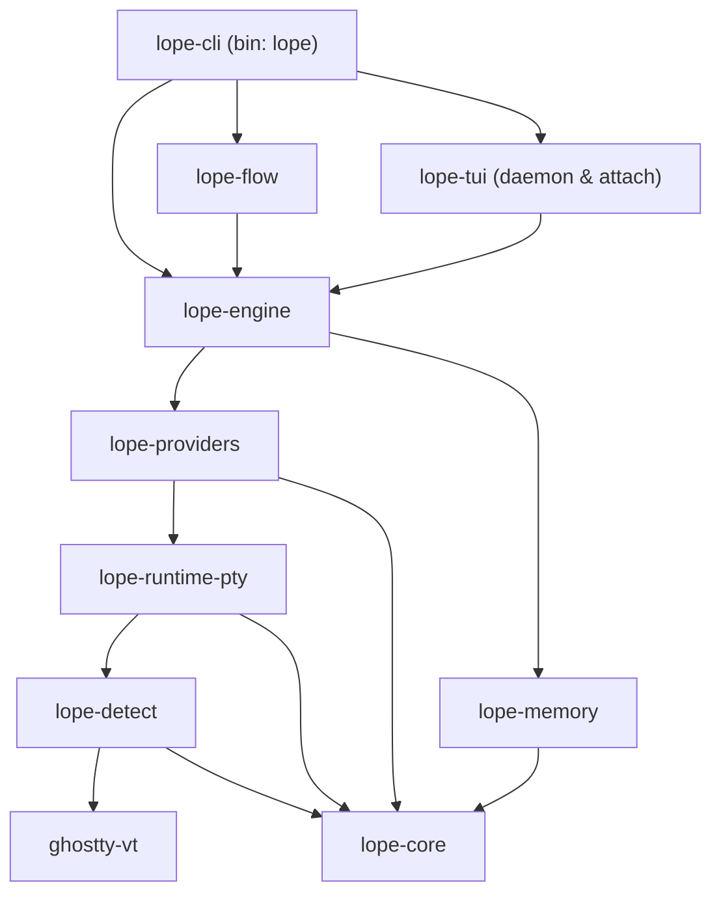

# Spec 01: Product, Architecture & Security

[Specs Index](README.md) · [Audits](../audits/README.md) · Next: [02 — Use Cases & Scenarios](02-use-cases-and-scenarios.md)

---

## 1. Product Definition & The Fusion Matrix

**Super Lope** (`lope` v2.0) fuses the multi-model ensemble intelligence of **Python Lope (`0.17.3`)** with the terminal runtime, virtual terminal emulation, and real-time screen-state detection of **Rust Herdr (`0.9.5`)**, unified on the **Makakoo OS (`0.4.0`)** Rust stack.

| Capability Layer | Origin System | How Super Lope Fuses It in Rust |
|---|---|---|
| **Virtual Terminal Emulation** | Herdr (`crates/ghostty-vt`) | Embedded directly in workspace crate `ghostty-vt`. Every CLI validator runs against an in-memory VT grid (`80x24` or `120x40`) that tracks text, ANSI styles, cursor, and `osc_title`. |
| **Non-Blocking PTY Actor** | Herdr (`src/pty/actor.rs`, `vendor/portable-pty`) | Extracted into `lope-runtime-pty`. Uses `tokio` + `portable-pty` with structured `SubmitUserInput` and decoupled leader-PID reaping (`waitpid`). |
| **22-Agent Screen Detector** | Herdr (`src/detect/`, `manifests/*.toml`) | Extracted into `lope-detect`. Compiles all 22 agent `.toml` manifests into the binary via `include_str!` (with optional user overrides in `~/.lope/manifests/`) and classifies panes into `Idle`, `Working`, `Blocked(RuleId)`, or `Unknown`. |
| **Warm Agent Daemon & Remote SSH** | Herdr (`src/server/headless.rs`, `src/remote/`) | Adapted into `loped` (`lope daemon start`). Keeps warm agent panes alive across invocations and optionally dispatches validator panes to remote SSH machines (`traylinx-ci` / `hz`). |
| **Live Split-Pane TUI** | Herdr (`src/ui/`, `ratatui 0.30`) | Extracted into `lope-tui`. Running `lope attach` attaches to a running Council/Sprint/Flow session to view all validator panes side-by-side and answer `Blocked` prompts live. |
| **15 Built-In CLI + Generic HTTP Validators** | Lope (`validators.py`, `generic_validators.py`, `curl_parser.py`) | Rebuilt in `lope-providers` using native `reqwest` (`rustls-tls`) for HTTP providers and `lope-runtime-pty` for CLI providers, plus native `--from-curl` parsing. |
| **Consensus Review & 7 Role Lenses** | Lope (`review.py`, `findings.py`, `sarif.py`) | Rebuilt in `lope-engine::review` with deterministic finding parser, fuzzy line/message deduplication, quorum scoring, 7 Glimmer lenses (`--focus`), and SARIF 2.1.0 export. |
| **7-Stage Council Deliberation** | Lope (`deliberation.py`, `synthesis.py`) | Rebuilt in `lope-engine::deliberate` with 6 built-in templates (`adr`, `prd`, `rfc`, `build-vs-buy`, `migration-plan`, `incident-review`), anonymized `Response A/B/C` critique, rubric scoring, and minority reports. |
| **Sprint & Self-Healing Engine** | Lope (`negotiator.py`, `executor.py`, `implement.py`, `gates.py`) | Rebuilt in `lope-engine::sprint` supporting `negotiate --domain {engineering,business,research}`, `implement` (with child-worktree verification), `execute`, `audit`, and `gate`/`check`. |
| **Declarative DOT Flow Engine** | Lope (`lope/flow/*.py`) | Rebuilt in `lope-flow`. Parses Graphviz `.dot` graphs, executes wave-based fan-out / barrier fan-in nodes (`agent`, `review`, `judge`, `script`), and enforces strict visit-cap cost bounds. |
| **SQLite Finding Memory & Makakoo Bridge** | Lope (`memory.py`, `makakoo_bridge.py`) | Rebuilt in `lope-memory` using `rusqlite` (`bundled-full` with FTS5). Shares `~/.lope/memory.db` schema and bridges to `$MAKAKOO_HOME/data/Brain/` (`--brain-context`, `--brain-log` + `makakoo sync`). |

---

## 2. Cargo Workspace Architecture (`/Users/sebastian/Projects/apps/super-lope`)

Super Lope is organized as a modular 10-crate Rust `2021` Cargo workspace:

```text
/Users/sebastian/Projects/apps/super-lope/
├── Cargo.toml                        # Workspace root (shared deps aligned with makakoo-os & herdr)
├── vendor/
│   └── portable-pty/                 # Patched portable-pty 0.9.0 from herdr
└── crates/
    ├── ghostty-vt/                   # 1. Herdr's Ghostty VT screen buffer crate (copied intact)
    ├── lope-core/                    # 2. Domain models, config.json/toml, budgets, leases, redaction, verdict parser
    ├── lope-detect/                  # 3. Herdr's screen detector + 22 embedded .toml agent manifests + Blocker Policy
    ├── lope-runtime-pty/             # 4. Async PTY actor, leader-exit reaper, bounded stream capture, process groups
    ├── lope-providers/               # 5. Tier 1 (reqwest HTTP), Tier 2 (One-Shot PTY), Tier 3 (Warm Pool), curl parser
    ├── lope-memory/                  # 6. Rusqlite finding store (~/.lope/memory.db), SARIF exporter, Makakoo Brain bridge
    ├── lope-engine/                  # 7. Single-shot (ask/vote/compare/pipe), Consensus Review, 7-Stage Deliberation, Sprints
    ├── lope-flow/                    # 8. Graphviz DOT parser, validator, wave runner, blackboard & HTML/ASCII renderer
    ├── lope-tui/                     # 9. Ratatui live split-pane Council/Sprint monitor (`lope attach`) & daemon server (`loped`)
    └── lope-cli/                     # 10. Binary entrypoint (`lope`) implementing all 23 legacy verbs + 4 new verbs
```

### Strict Dependency DAG (No Cycles)


---

## 3. Runtime Contexts (`C1`–`C6`)

Every Super Lope invocation runs in one of six deterministic runtime contexts:

| ID | Context Name | Trigger | Execution Behavior |
|---|---|---|---|
| **`C1`** | **Headless Ephemeral CLI (Daemon Down)** | User, script, or Glimmer runs `lope <verb>` when `loped` (`~/.lope/run/lope.sock`) is not running. | Runs in-process inside `lope` using **Tier 1 (Native HTTP)** for HTTP providers and **Tier 2 (Managed One-Shot PTY)** for CLI providers. Zero daemon required. |
| **`C2`** | **Daemon-Accelerated CLI (Daemon Up)** | User or Glimmer runs `lope <verb>` when `loped` socket `~/.lope/run/lope.sock` is live and verified (`LOCAL_PEERCRED`). | Routes warm-eligible CLI validators through **Tier 3 (Warm Agent Pool)** in `loped` for instant dispatch, falling back transparently to Tier 2 if a pool slot is busy. |
| **`C3`** | **Glimmer Watched Terminal (`orca-terminal-host`)** | Glimmer spawns `lope review`, `lope negotiate`, or `lope implement` inside a watched background PTY tab (`GLIMMER_SOCKET` set). | Streams clean progress lines to the terminal, writes `--output <path>` atomically on completion, updates `~/.lope/state/sprints/` manifest, and survives `Cmd-Q` of the Glimmer GUI window. |
| **`C4`** | **Interactive Live Council TUI (`lope attach`)** | User runs `lope attach [<run-id>]` or passes `--watch` in an interactive terminal (`isatty(stdin) == 1`). | Connects to `loped` over `~/.lope/run/lope-client.sock` and renders a Ratatui split-pane grid showing each validator's live PTY screen, status badge (`WORKING`, `BLOCKED`, `DONE`), and elapsed timer. |
| **`C5`** | **Nested Agent Call (`LOPE_IMPLEMENTATION_DEPTH > 0`)** | An implementation agent spawned by `lope implement` invokes `lope` recursively. | Increments `LOPE_IMPLEMENTATION_DEPTH`. Enforces recursion depth cap (`max_depth = 2`) and inherits parent run budget lease so recursive calls cannot exceed parent cost/time limits. |
| **`C6`** | **Remote SSH Offload (`--machine <host>`)** | User or config assigns a heavy validator to a saved SSH host (e.g. `traylinx-ci`). | Connects to remote `loped` / `herdr` endpoint over SSH control socket and streams prompt/verdict without taxing local Intel Mac CPU/RAM. |

---

## 4. The 3-Tier Validator Execution Engine

### Tier 1: Native Async HTTP (`lope-providers::http`)
- Used for all `"type": "http"` providers in `~/.lope/config.json`, `switchAILocal` (`http://127.0.0.1:18080/v1`), OpenAI-compatible gateways, and providers added via `lope team add --from-curl`.
- Uses a shared `reqwest::Client` (`rustls-tls`, HTTP/2 connection pooling, TCP keepalive).
- **Zero subprocesses, zero PTY allocation, `< 1ms` dispatch overhead.**

### Tier 2: Managed One-Shot PTY (`lope-runtime-pty::oneshot`)
- Used for CLI validators invoked with non-interactive flags (`claude --print`, `codex exec`, `gemini --prompt`, `opencode run`, `grok`, `agy`, `kimi`) when warm pool mode is disabled or unavailable.
- Spawns the CLI inside a dedicated `portable-pty` pseudo-terminal (`120 cols × 40 rows`) with its own POSIX session (`setsid`) and feeds output bytes into `ghostty-vt`.
- **Every `50ms` after a screen dirty event**, `lope-detect` evaluates the active agent's `.toml` manifest against the `ghostty-vt` screen buffer:
  - If `AgentState::Working`: resets the stall watchdog while respecting the overall call deadline.
  - If `AgentState::Blocked`: triggers the **Blocker Policy Engine** (Section 5) in `< 250ms`.
- **Leader-Completion Reaping Rule (`FR9`, fixes `D1` & `D5`)**:
  - As soon as `waitpid(leader_pid, WNOHANG)` reports that the direct CLI leader process has exited (`status == 0`) and buffered PTY output has been drained (`100ms` quiet grace), the output is captured and returned as `OutcomeClass::Ok`.
  - A background Tokio cleanup task then sends `SIGTERM` → (`200ms`) → `SIGKILL` to `-pgid` to clean up any orphaned MCP servers or helpers without blocking or failing the completed validator call.

### Tier 3: Persistent Warm Agent Pool (`lope-tui::pool`)
- Managed by `loped` (`lope daemon start`).
- Pre-warms configurable interactive agent panes (`claude`, `codex`, `gemini`, `opencode`) in a dedicated sandboxed workspace (`~/.lope/run/warm-workspace/`).
- When `AgentState::Idle` is detected on the prompt box, the pane is marked `Ready`.
- On a review/ask/deliberate request, `loped` leases a `Ready` pane, injects the prompt via `PtyIoActorHandle::SubmitUserInput`, waits for `Idle -> Working -> Idle` state transition via `EventHub`, extracts the clean response turn from the `ghostty-vt` buffer, and resets the context (`/clear` or `/reset`) for the next lease.
- Eliminates the `1.5s–3.5s` Node.js/Python startup overhead on repeated calls.

---

## 5. The Blocker Policy Engine (Eliminating Blind Timeouts)

When `lope-detect` matches a rule with `state = "blocked"` and `visible_blocker = true`, Super Lope classifies the rule ID into one of three deterministic actions:

| Policy Class | Matched Manifest Rules | Action Taken (`< 250ms`) |
|---|---|---|
| **1. `AutoRemediateSafe`** | • `startup_update` (`codex.toml`, `claude.toml`, `grok.toml`: "Update available! Skip / Press enter")<br>• `trust_directory` / `trust_prompt` (`codex.toml`, `claude.toml`, `antigravity.toml`: "Do you trust the contents of this directory?") **ONLY when `cwd` is an verified Lope-owned scratch dir or registered user workspace** | Sends the exact dismissal/confirm keystroke sequence (`Esc` or `Enter`) via `PtyIoActorHandle`, logs a `blocker_remediated` telemetry event in the run manifest, and continues waiting for `Working -> Idle`. (Capped at `2` auto-remediations per call to prevent loops). |
| **2. `FailFastImmediate`** | • `auth_error` / login prompts<br>• `rate_limit_modal`<br>• `permission_prompt` / `live_strong_blocker` / `mcp_elicitation_prompt` during a read-only `review` or `ask` call (where a validator is forbidden from mutating files or running shell commands) | Immediately terminates the validator call in `< 250ms` (unless a live `lope attach` operator is connected and `--interactive-blockers` is enabled), records `OutcomeClass::Blocked { rule_id, screen_excerpt }`, and lets the ensemble proceed with remaining healthy validators instead of hanging for `900s`. |
| **3. `InteractiveDelegate`** | • `question_prompt` / `permission_prompt` when an operator is attached via `lope attach` (or `human_questions = "blocking"` in `deliberate`) | Highlights the pane in red (`BLOCKED`) in `lope attach`, emits a desktop/terminal notification, and waits for the human operator to answer in the TUI pane. |

---

## 6. Security, Privacy & Resource Boundaries

1. **Socket Security (`NFR3`)**:
   - `~/.lope/run/` is created with mode `0700`; `~/.lope/run/lope.sock` and `lope-client.sock` are created with mode `0600`.
   - Every connection verifies peer UID == `geteuid()` via `LOCAL_PEERCRED` / `getpeereid` on macOS/Linux (and SID owner SDDL on Windows).
2. **No Shell Interpolation (`NFR4`)**:
   - All subprocesses and PTYs spawn via explicit `Command::new(program).args(argv)` arrays (`shell = false`). `{prompt}` tokens in `config.json` substitute as discrete `argv` elements or temp files (`0600`), never shell strings.
3. **Canonical Redaction Pipeline (`NFR5`)**:
   - Before any text is written to stdout, `--output`, `~/.lope/memory.db`, `$MAKAKOO_HOME/data/Brain/`, or SARIF reports, `lope-core::redaction` scrubs API keys (`sk-`, `ghp_`, `gho_`, `AKIA`, `AIza`, `xoxb-`), PEM private keys (`-----BEGIN`), Bearer tokens, and values of secret env vars configured in `~/.lope/config.json`.
4. **Manifest Privacy Invariant (`NFR6`)**:
   - Run manifests in `~/.lope/state/sprints/` forbid raw prompts, responses, `argv`, and `env` values (`_FORBIDDEN_MANIFEST_KEYS` contract preserved from Python `lope/jobs.py:37-48`). Only SHA-256 hashes and metadata are stored.
5. **Intel Mac Concurrency & Memory Caps (`NFR2`)**:
   - Default max concurrent local PTY validators is `4` (configurable via `max_parallel_ptys`), preventing CPU/thermal thrashing on the dual/quad-core Intel Mac while allowing unlimited concurrent Tier 1 async HTTP calls.

---

[Specs Index](README.md) · Previous: [Specs Index](README.md) · Next: [02 — Use Cases & Scenarios](02-use-cases-and-scenarios.md)
