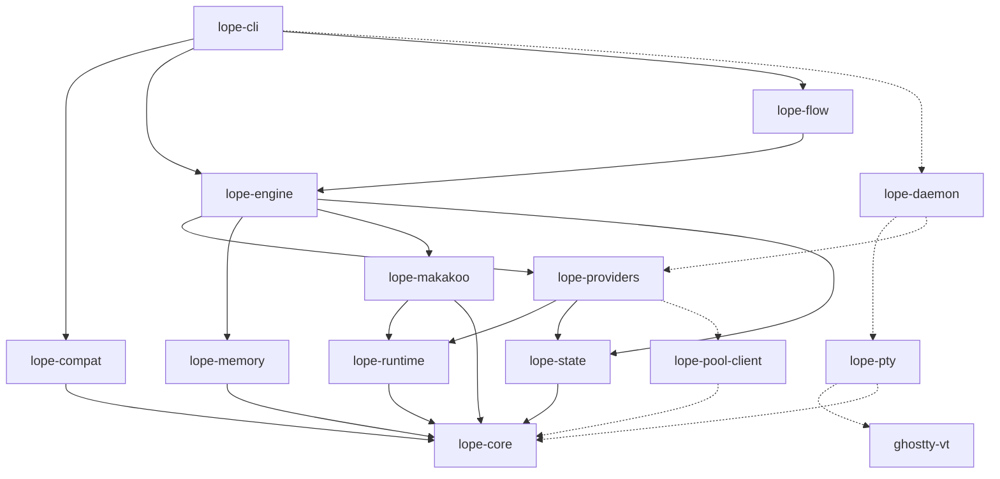

# Spec 01 — Product & architecture

[Specs](README.md) · Next: [02 — Use cases](02-use-cases-and-scenarios.md)

## 1. Product

Super Lope is a Rust implementation of the `lope` CLI. It is a **behavioural drop-in** for Python Lope at the pinned commit (see [PL-1](04-interfaces-and-protocol.md#8-cross-repo-patch-sets)) for every caller listed in [Audit 03](../audits/03-makakoo-and-glimmer-seams-audit.md).

Success means three things:
1. Every caller works unchanged, or with the explicit patch sets in Spec 04 §8.
2. State stays readable by Python Lope at every step, so rollback is a binary switch.
3. The verified defects are fixed or instrumented: D1 and D5 are latent, D2 is unproven, D3 is partial, D4 and D6 are confirmed (defect matrix).

What it is not, in v2.0:
- a terminal multiplexer, a GUI, or a remote executor;
- a re-architecture of Lope's ensemble semantics.

Lope's protocols (verdict blocks, consensus scoring, deliberation, sprint, flow) are **ported**, not redesigned.

## 2. Runtime contexts (C1–C7)

| ID | Context | Caller | Facts that constrain the design |
|---|---|---|---|
| **C1** | Interactive shell | user, agent CLIs via skills | `alias lope` (`~/.zshrc:178`, `~/.bashrc:33`) and `~/bin/lope` take precedence over `/usr/local/bin/lope`. Until patch set PH lands, interactive shells keep running Python. |
| **C2** | Glimmer watched PTY tab | G4 review, G7 negotiate, G8 implement | Stdout is piped to `tee` (not a TTY); stderr and stdin are the PTY. Stdout **is** the report. `implement` with no roster flags prompts on the TTY. Exit status is lost under zsh (Glimmer bug PG-6). |
| **C3** | Glimmer companion (headless) | G2 health, G3 `jobs prune --stale`, G5 review | launchd environment; stdout redirected to `.jungle/reviews/<id>.md`; `PYTHONPATH=$LOPE_HOME` set; cancel = SIGTERM to the Lope PID only. |
| **C4** | Glimmer doctor | G1 | `lope version`, inherits the user env, 10 s timeout, first `N.N` on stdout. |
| **C5** | Makakoo | M1 gym gate (**Python import, not CLI**), M2 `setup lope`, M4 onboarding (writes `config.json`), M3 adapter validators called *by* Lope | M1 and M2 break if the Python package disappears or moves. |
| **C6** | Nested implementation writer | any process with `LOPE_IMPLEMENTATION_DEPTH > 0` | Every `lope` command must exit 2 (`cli.py:182-192`). |
| **C7** | Daemon-accelerated (S9 only) | any verb, when `loped` is up and the provider opts in | Must fall back silently to Tier 2. |

## 3. Workspace layout

```text
super-lope/
├── Cargo.toml                  workspace; deps aligned with makakoo-os where shared
├── rust-toolchain.toml         pinned; build scripts call rustup's cargo (Homebrew cargo 1.89 shadows it)
├── crates/
│   ├── lope-core/              paths ($LOPE_HOME), config.json (Python format) + super-lope config.toml,
│   │                           models, redaction, verdict parser/repair prompts, exit codes, env registry
│   ├── lope-state/             runs/ registry + manifests, run.lock, latency.json, trusted_gates.json,
│   │                           audit journal, heal journal
│   ├── lope-runtime/           supervised one-shot processes over pipes (Tier 2), process groups,
│   │                           deadlines, signals, temp files; platform::{macos,linux}
│   ├── lope-providers/         built-ins, presets, generic subprocess/HTTP (Tier 1, reqwest+rustls),
│   │                           makakoo adapters, learned adapters, curl parser, retry, request plan/budgets
│   ├── lope-memory/            memory.db (rusqlite, bundled SQLite; Python schema)
│   ├── lope-makakoo/           brain context, brain log, auto-memory
│   ├── lope-engine/            ask/vote/compare/pipe, review + findings + SARIF + exporters + divide/roles
│   │                           + minimality + synthesis, deliberation, sprint (negotiate/execute/implement/
│   │                           audit/gates/trust/healer)
│   ├── lope-flow/              DOT parser, validator, runner, render, templates
│   ├── lope-compat/            strangler router, argv normalisation (DEC-11), Python delegation,
│   │                           parity introspection tooling
│   └── lope-cli/               `lope` binary
├── crates-pty/                 built only with `--features pty-pool` (S9)
│   ├── ghostty-vt/             from Herdr + vendor/libghostty-vt (Zig 0.16)
│   ├── lope-pty/               PTY actor (new), Herdr detection matcher + manifests, stabiliser port
│   ├── lope-pool-client/       socket client used by lope-providers (keeps the DAG acyclic)
│   └── lope-daemon/            `loped`
├── vendor/                     S9 only: libghostty-vt, portable-pty (MIT) + provenance files
└── tools/parity/               argparse introspection dumper, golden-run harness
```

**Dependency DAG** (no cycles; `pty-pool` edges dashed):



Shared dependency versions follow `makakoo-os/Cargo.toml` where both use a crate:
- `tokio 1.40`
- `rusqlite 0.32 (bundled)`
- `reqwest 0.12` with `default-features = false` and `json`, `rustls-tls`
- `clap 4`
- `serde 1`, `serde_json 1`
- `regex 1.11`
- `sha2 0.10`
- `toml 0.8`

Crossterm and ratatui are needed only if a TUI is ever built (L6).

## 4. Execution tiers

| Tier | Used for | Mechanism | Sprint |
|---|---|---|---|
| **T1 — HTTP in-process** | `"type": "http"` providers, `--from-curl` providers | Shared `reqwest::Client` (rustls). `{prompt}` is substituted by walking the JSON value, never by string concatenation. `${ENV}` is expanded in headers/body as Python does. Response is extracted via `response_path`. No child processes. | S3 |
| **T2 — Supervised one-shot (pipes)** | All CLI validators: built-ins, presets, subprocess providers, `makakoo adapter call` | Command plus args (no shell), in a new session and process group. Prompt goes on stdin then stdin is closed, or in argv, or in a 0600 temp file, exactly as Python's adapter specifies. Stdout and stderr are captured separately with bounded head+tail (2 MiB / 512 KiB). Deadline. Completion policy in §7. | S2 |
| **T3 — Warm PTY pool** | Opt-in per provider (`super-lope/config.toml`) for interactive TUIs only | `loped`, PTY + `ghostty-vt`, Herdr detection plus the stabiliser, blocker policy with Lope-authored rules and keys. | S9 (gated, OQ-4) |

There is no tier that runs `--print`/`exec` CLIs under a PTY (DEC-2).

## 5. Strangler routing (DEC-1)

1. Apply the nesting guard first, exactly where Python does (`cli.py:182-192`, before any parsing): `LOPE_IMPLEMENTATION_DEPTH > 0`, or not an integer → print Python's exact message and exit 2 (FR4).
2. Normalise argv: `review … --consensus quorum` → `--consensus`; `negotiate … --rounds N` → `--max-rounds N`; top-level `--version`/`-V` → `version` (FR2, FR23). Tokens are classified the way argparse does, so option values, `--`, abbreviations and negative numbers are never rewritten.
3. Look up `(verb, subcommand, flag set)` in the **native coverage table**, which is compiled in and grows sprint by sprint. The flag set comes from parsing with the clap grammar generated from the argparse capture. If covered, run natively. A clap parse error (including `--help`) counts as not covered, so Python prints its own usage errors and help.
4. Otherwise `exec` Python Lope: `python3 -m lope <normalised argv>` with `PYTHONPATH=$LOPE_HOME` (default `~/.lope`). The interpreter is resolved as `LOPE_PYTHON`, then `/usr/bin/python3`, then `python3` on `PATH`. `exec` replaces the process, so env, cwd, stdio, signals and exit status are preserved by construction. SIGPIPE is reset to the default before `exec`, because Rust ignores it at startup and ignored signals survive `exec`.
5. `LOPE_FORCE_PYTHON=1` forces step 4 for every verb; `LOPE_FORCE_NATIVE=1` makes unported invocations fail with exit 2. If both are set, Python wins (rollback safety). Both exist for the parity harness and for rollback. `LOPE_ROUTER_TRACE=1` prints the routing decision on stderr.

The coverage table (`crates/lope-compat/src/coverage.rs`) is the single place that says what is native. `lope-parity-dump --coverage` prints it with its fingerprint, `lope status` will print the fingerprint once it is native (S1), and `docs/evidence/` records it at each sprint end.

## 6. Herdr reuse: what is taken and what is not

See the [Audit 02 §7](../audits/02-herdr-rust-audit.md#7-what-super-lope-should-take-feeds-spec-01-6) decision table. In short:
- **S9 only, feature-gated:** the detection matcher and manifests, the stabiliser, `ghostty-vt` + `libghostty-vt`, and `portable-pty`.
- **Re-implemented, not extracted:** the PTY actor and the socket server.
- **Not in v2.0:** remote SSH and the UI stack.

Obligations: Apache-2.0 NOTICE for Herdr-derived code, MIT licence files for portable-pty and libghostty-vt, and modified-file marking (NFR12).

## 7. Completion policy (DEC-4; fixes D1 and D5 without weakening safety)

For every T2 call:

1. Spawn the leader with `setsid` (pgid = pid). Write the prompt to stdin, then close it, or pass it in argv or a temp file per the adapter.
2. Read stdout and stderr asynchronously into bounded buffers. Await leader exit with `waitpid` through tokio's child handle. There is no sleep-polling while the call is running.
3. When the leader exits: send `SIGTERM` to `-pgid`, wait 200 ms, send `SIGKILL` to `-pgid`, then confirm the group is empty (`killpg(pgid, 0)` returns `ESRCH`). Confirmation uses a bounded back-off within the **cleanup budget**, default 2.0 s, configurable, and tuned with S2 evidence. Python's budget is 0.7 s.
4. Drain the pipes until EOF, or until 500 ms after the group is confirmed empty.
5. Classify:

   | Condition | Outcome |
   |---|---|
   | Leader exit 0, group empty, pipes at EOF, stdout under the limit | `ok` |
   | Group still has members after the budget | `UNVERIFIED` (`cleanup_failed:descendants_live`) with `{cleanup, stdout_complete, stdout_truncated, returncode}` metadata. Output is only exposed under `LOPE_RECOVER_UNVERIFIED_OUTPUT=1` (Python WIP parity) |
   | Group empty but a pipe is still held open by a process that left the group | `UNVERIFIED` (`output_drain_timeout`), same metadata |
   | Non-zero exit, limits exceeded, or timeout | Python's existing outcomes, unchanged |

6. Write the cleanup result to the call manifest (fields allowed by NFR5).

Fail-open acceptance is available only through an explicit setting in `super-lope/config.toml` (OQ-6).

## 8. Security and privacy

- **No shell for validators.** Gate commands and flow `script` nodes run exactly as Python runs them, under the same trust store (`trusted_gates.json`, `--trust`, `LOPE_TRUST_GATES`, exit 3 when untrusted).
- **Redaction** ports `redaction.py` exactly (`:20-36`): PEM private-key blocks, `sk-…`, `gh[pousr]_…`, `Bearer …`, and `api_key|x-api-key|authorization|token|access_token|secret` assignments. It applies before anything reaches stdout, files, `memory.db`, the Brain or SARIF. Any additional patterns are additive and listed in FR26.
- **Manifest privacy:** `_FORBIDDEN_MANIFEST_KEYS` (10 keys, NFR5).
- **Temp files:** 0600 files, 0700 directories, removed on drop, panic or cancellation.
- **`~/.lope` stays a clean git tree.** Rust writes only to paths already in `~/.lope/.gitignore`. Its own directory `~/.lope/super-lope/` may be written only after PL-2 adds it to `.gitignore` (NFR7).
- **S9 socket:** directory 0700, socket 0600, **plus** a `getpeereid` UID check. This is new code; Herdr has no peer-UID check.

## 9. Build

- Pin the toolchain in `rust-toolchain.toml` and build through rustup's cargo (`~/.cargo/bin/cargo` or `rustup run <toolchain> cargo`). The Homebrew `cargo 1.89` on `PATH` ignores the pin.
- The default build uses cargo and crates.io only. `--features pty-pool` additionally needs Zig 0.16 and either network access for the `uucode` fetch or `LIBGHOSTTY_VT_ZIG_SYSTEM_DIR`.
- Release profile mirrors makakoo-os (`lto`, `strip`, `codegen-units = 1`). The binary links dynamically to libSystem; a fully static macOS binary is not possible.
- Verify an **x86_64 build on the Intel Mac itself**. Herdr only cross-builds x86_64 on ARM.
